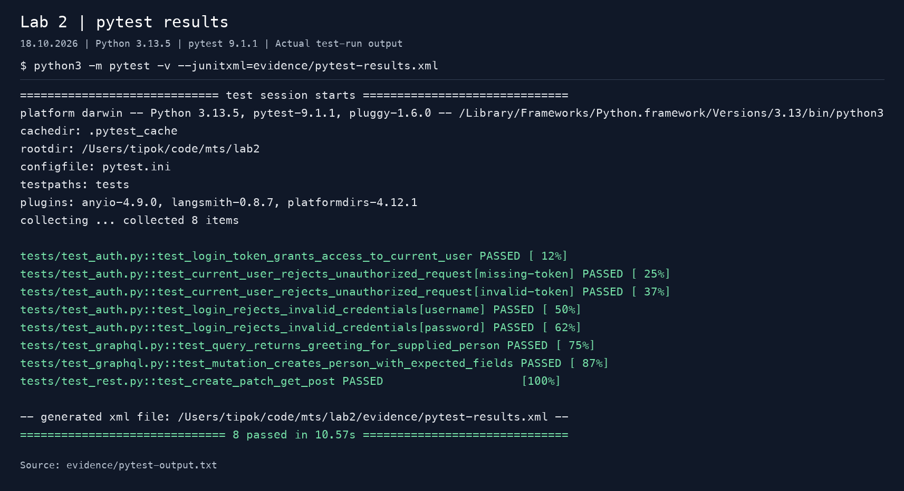
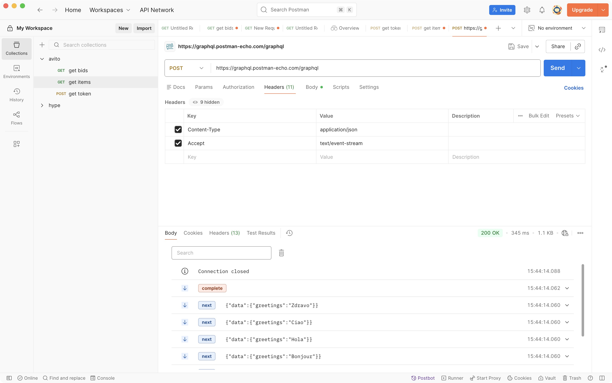

# Домашняя работа 2

Решение на **Python + pytest + requests**. Python разрешён в начале
условия, поэтому вместо Maven используется `pytest`

## Установка и запуск

Python 3.10 или новее. Из корня репозитория:

```bash
python3 -m venv .venv
source .venv/bin/activate
python -m pip install -r requirements.txt
python -m pytest -v
```

В Windows вместо `source` выполните `.venv\Scripts\activate`.
После установки зависимостей полный прогон из корня:

```bash
python -m pytest
```

Отдельные блоки:

```bash
python -m pytest tests/test_rest.py -v
python -m pytest tests/test_auth.py -v
python -m pytest tests/test_graphql.py -v
```

## API и тестовые данные

- REST: <https://playground.nileslabs.com/api/v1>.
- Актуальная схема REST: <https://playground.nileslabs.com/api/v1/downloads/openapi.json>.
- GraphQL: <https://graphql.postman-echo.com/graphql>.

**Расхождение с условием, проверенное 18.10.2026:** `Bret / password123` из PDF
возвращает `401 Invalid username or password.`. В актуальной OpenAPI-схеме указана
пара `Bret / Password@123`; она успешно возвращает токен. Эта пара используется
по умолчанию. Для других учебных учётных данных:

```bash
API_USERNAME=Bret API_PASSWORD='Password@123' python -m pytest -v
```

Токены всегда запрашиваются во время теста и не сохраняются в файлы.
Динамический `id` поста берётся из ответа POST. Стенд выдаёт строковый
`local-<uuid>`, поэтому тест не приводит его к `int`.

## Реализованные сценарии

| Блок | Проверки |
| --- | --- |
| REST | POST `/posts` -> `201`, извлечение `id` -> PATCH `/posts/{id}` -> GET того же поста. Проверяются `id`, новое значение `title` и сохранение `body` в ответах PATCH и GET. Свой пост удаляется в `finally`. |
| Авторизация | POST `/auth/login` -> `200`, непустой строковый `access_token` -> GET `/auth/me` с `Authorization: Bearer <token>`. Проверяются `id`, `username`, `name`, `email` и совпадение с пользователем из login. |
| Негативная авторизация | Два независимых случая: отсутствующий и неверный токен. Ожидаются `401`, содержательное сообщение об отказе и отсутствие профиля пользователя. |
| GraphQL query | `hello(person: $person)` с переменными. Проверяются HTTP `200`, `data.hello`, точное приветствие для переданного имени и отсутствие `errors`. |
| GraphQL mutation | `createPerson(person: $person)`. Проверяются HTTP `200`, `data`, непустой строковый `id`, переданные `name` и `age`, отсутствие `errors`. |
| Дополнительный сценарий | Параметризованный login с неизвестным логином или неверным паролем. Проверяются `401`, сообщение `Invalid username or password.` и отсутствие обоих токенов. |
| GraphQL subscription | Готовый HTTP/SSE-запрос `subscription Greetings { greetings }` в импортируемой Postman collection. |

Всего **8 тестовых случаев** в pytest. Они независимы от порядка запуска.
Для каждого теста создаётся отдельная `requests.Session`; внутри REST-сценария
сохраняется cookie `pg_identity`, связывающая запросы с одной песочницей.
Тесты создают собственный пост и не меняют заранее существующие записи.

## Subscription в Postman

1. Откройте Postman и выберите **Import**.
2. Импортируйте `postman/subscription.postman_collection.json`.
3. Откройте **Lab 2 - GraphQL subscription (SSE)** -> **Greetings - SSE subscription**.
4. Нажмите **Send**. В запросе уже заданы `Content-Type: application/json`
   и `Accept: text/event-stream`.
5. Проверьте HTTP `200`, тип ответа `text/event-stream` и несколько входящих
   событий `next`. В JSON каждого события ожидается непустая строка
   `data.greetings` без `errors`.
6. Дождитесь события `complete` или остановите поток кнопкой **Cancel**
   после получения нескольких событий.

Тело запроса:

```graphql
subscription Greetings {
  greetings
}
```

Автоматизация subscription в pytest по условию не требуется.

## Результат проверки

Проверено **18.10.2026** на Python 3.13.5: **8 passed in 10.57s**.
Все тесты выполнены против указанных выше API. Машиночитаемый отчёт:
[evidence/pytest-results.xml](evidence/pytest-results.xml).

Изображение ниже построено из фактического вывода полного прогона pytest.
Исходный текст: [evidence/pytest-output.txt](evidence/pytest-output.txt).



Subscription выполнена в Postman 11.87.4: получены HTTP `200`,
`Content-Type: text/event-stream` и пять событий `next` с `data.greetings`:
`Hi`, `Bonjour`, `Hola`, `Ciao`, `Zdravo`. Во всех событиях нет `errors`;
затем сервер прислал `complete` и закрыл поток.



